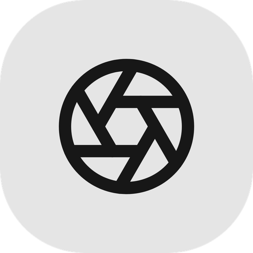
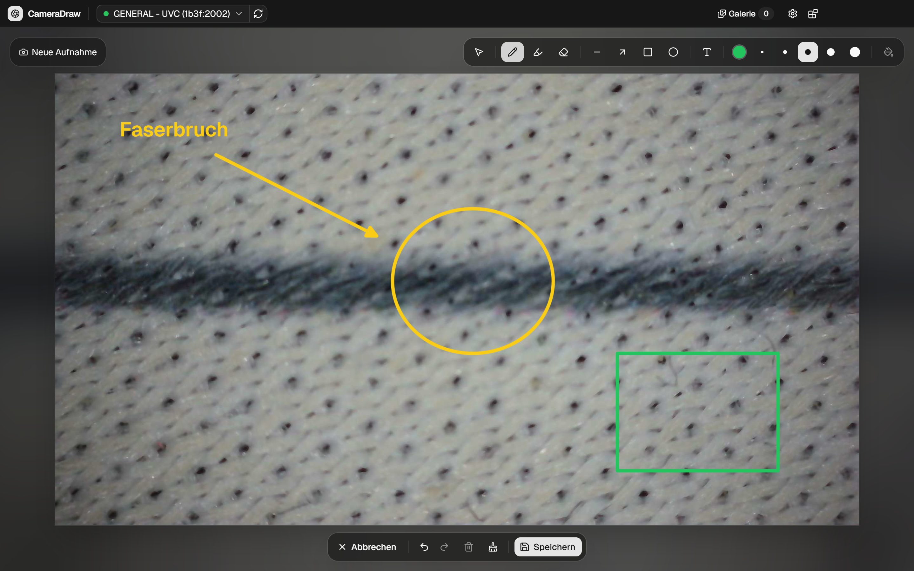
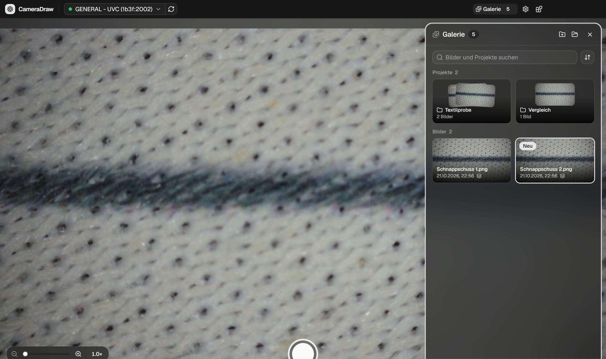
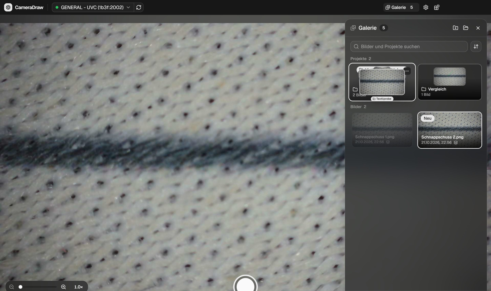
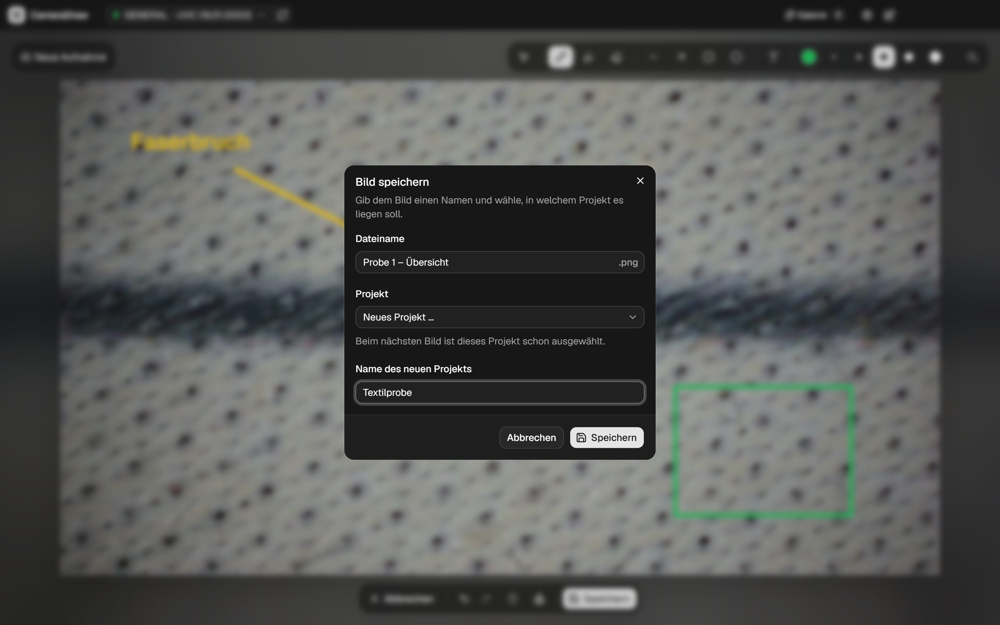

<div align="center">



# CameraDraw

**Kamerabild anhalten, darauf zeichnen, sauber ablegen.**

Desktop-App für USB-Mikroskope und Webcams – mit Projekten, Galerie und Zeichnungen,
die auch später noch Form für Form bearbeitbar bleiben.




</div>

## Funktionen

- **Einfrieren und zeichnen** – `Leertaste` oder die Foto-Taste am Mikroskop hält das Bild an.
  Stift, Textmarker, Linie, Pfeil, Rechteck, Ellipse, Text und Radierer, dazu Rückgängig und
  Wiederholen. Für Details lässt sich das Bild bis 8× vergrößern und verschieben.
- **Serienaufnahme** – Viele Bilder hintereinander, ohne jedes Mal den Editor: Mit eingeschalteter
  Serienaufnahme speichern `Leertaste`, Auslöser und Foto-Taste das Bild sofort ins gewählte
  Projekt, `Shift+Leertaste` tut das auch einzeln. Gezeichnet werden kann später – „Bearbeiten“ im
  Hinweis oder in der Galerie.
- **Messen** – Strecken im Bild messen, in µm/mm, sobald ein Maßstab festgelegt ist (z. B. mit einem
  Lineal, siehe unten).
- **Kontextmenü im Editor** – Text genau an der angeklickten Stelle einfügen, Formen nachträglich
  füllen, kopieren, duplizieren, nach vorne oder hinten legen, löschen, alles auswählen.
- **Formen kopieren** – `Strg+C` / `Strg+V` / `Strg+D`, auch von einem Bild ins nächste (Messlinien
  zeigen dort die Länge im Maßstab des neuen Bildes). Die Pfeiltasten schieben die Auswahl
  pixelgenau.
- **Bleibt bearbeitbar** – Neben jedem Bild liegen das Original und die Zeichnung als Ebenen. Wer
  ein Bild wieder öffnet, kann jede Form und jeden Text einzeln verschieben, ändern oder löschen.
- **Projekte** – Beim Speichern fragt CameraDraw nach Dateiname und Projekt (oder „Kein Projekt“).
  Das zuletzt gewählte Projekt ist beim nächsten Bild schon ausgewählt. Ein gespeichertes Bild
  speichert `Strg+S` direkt, „Speichern unter …“ legt es auf Wunsch als Kopie an.
- **Weitergeben** – `Strg+Shift+C` im Editor oder „Bild kopieren“ in der Galerie legt das Bild mit
  Zeichnung in die Zwischenablage, z. B. zum Einfügen in Word, Teams oder eine Mail.
- **Galerie** – Suche über alle Projekte, Sortierung nach Aufnahmedatum, Name oder Größe, Filter
  nach Zeitraum. Bilder lassen sich per Drag & Drop in Projekte ziehen, umbenennen (`F2`),
  verschieben und in den Papierkorb legen.
- **Kamera** – unterscheidet echte von virtuellen Kameras (OBS, DroidCam, …), verbindet sich nach
  dem Abziehen wieder mit genau derselben Kamera, zoomt mit der Kamera selbst oder digital.
- **Geräte-Module** – Gerätetypen bringen eigene Funktionen mit, z. B. Foto- und Zoom-Tasten des
  Generalplus-USB-Mikroskops.
- **Updates in der App** – CameraDraw meldet neue Versionen, lädt sie auf Wunsch herunter und
  installiert sie mit einem Neustart. Die Versionshinweise aller Versionen stehen im Updates-Panel.
- **KI-Steuerung (MCP)** – Auf Wunsch bedienen KI-Assistenten wie Claude Code die laufende App über
  einen MCP-Server: Bilder auswählen, Kamerabild anhalten, zeichnen, messen, speichern – live im
  Fenster zu sehen. Standardmäßig aus.

<table>
  <tr>
    <td width="33%"></td>
    <td width="33%"></td>
    <td width="33%"></td>
  </tr>
  <tr>
    <td align="center"><sub>Galerie mit Projekten</sub></td>
    <td align="center"><sub>Drag & Drop in ein Projekt</sub></td>
    <td align="center"><sub>Speichern mit Name und Projekt</sub></td>
  </tr>
</table>

## Schnellstart

**Installieren:** den Windows-Installer `cameradraw-<version>-setup.exe` aus den
[Releases](https://github.com/qzconnor/cameradraw/releases/latest) herunterladen und starten.
Weitere Updates kommen dann über die App.

**Aus dem Quellcode** – Voraussetzung: [Node.js](https://nodejs.org/) 22 oder neuer.

```bash
git clone https://github.com/qzconnor/cameradraw.git
cd cameradraw
npm install
npm run dev
```

Beim ersten Start fragt CameraDraw nach einem Speicherordner und einer Kamera. Beides lässt sich
später in den Einstellungen ändern.

## Bedienung

**Kamera**

| Taste                | Aktion                                                                                   |
| -------------------- | ---------------------------------------------------------------------------------------- |
| `Leertaste`          | Kamerabild anhalten und den Editor öffnen – in der Serienaufnahme: direkt speichern      |
| `Shift+Leertaste`    | Bild direkt speichern, ohne Editor (Name mit Uhrzeit, ins zuletzt gewählte Projekt)      |
| Foto-Taste am Gerät  | wie `Leertaste`, auch bei offener Galerie (USB-Mikroskop, braucht den Hintergrunddienst) |
| `+` / `−` / `0`      | Zoom vergrößern / verkleinern / zurücksetzen (auch per Mausrad)                          |
| Zoom-Tasten am Gerät | wie `+` / `−` (USB-Mikroskop, ohne Hintergrunddienst)                                    |
| `P`                  | Kamera pausieren / fortsetzen                                                            |
| `G`                  | Galerie öffnen / schließen                                                               |

**Editor**

| Taste                | Aktion                                                                 |
| -------------------- | ---------------------------------------------------------------------- |
| `V` `P` `M` `E`      | Auswählen, Stift, Textmarker, Radierer                                 |
| `L` `A` `R` `O` `T`  | Linie, Pfeil, Rechteck, Ellipse, Text (`Shift` = gerade / quadratisch) |
| `D`                  | Messen – Strecke mit Längenangabe (`Shift` = gerade)                   |
| Rechtsklick          | Text / Kopiertes hier einfügen, Kopieren, Duplizieren, Füllen, Löschen |
| `Strg+A`             | Alles auswählen (beim Schreiben: den Text markieren)                   |
| `Strg+C` / `Strg+X`  | Auswahl kopieren / ausschneiden                                        |
| `Strg+V` / `Strg+D`  | Einfügen (etwas versetzt, auch in ein anderes Bild) / Duplizieren      |
| Pfeiltasten          | Auswahl um 1 Pixel verschieben (`Shift` = 10 Pixel)                    |
| `Pos1` / `Ende`      | Auswahl in den Vordergrund / Hintergrund                               |
| `Strg+Z` / `Strg+Y`  | Rückgängig / Wiederholen                                               |
| `Entf`               | Auswahl löschen                                                        |
| `Strg+S`             | Speichern – neue Bilder mit Dateiname und Projekt, gespeicherte direkt |
| `Strg+Shift+S`       | Speichern unter … (neuer Name, anderes Projekt oder als Kopie)         |
| `Strg+Shift+C`       | Bild mit Zeichnung in die Zwischenablage kopieren                      |
| Mausrad / `+` `−`    | Zoomen (Mausrad: an der Mausposition), `0` zeigt wieder das ganze Bild |
| `Leertaste` + Ziehen | Ausschnitt verschieben (auch mit gedrückter mittlerer Maustaste)       |
| `Esc`                | Auswahl aufheben, sonst zurück zur Kamera                              |

**Galerie**

| Taste / Geste           | Aktion                                                                               |
| ----------------------- | ------------------------------------------------------------------------------------ |
| Bild auf Projekt ziehen | Bild in das Projekt verschieben (mit „Rückgängig“ im Hinweis)                        |
| `F2`                    | Bild oder Projekt umbenennen                                                         |
| Rechtsklick / `…`       | Bearbeiten, Bild kopieren, Umbenennen, Verschieben nach …, Im Ordner zeigen, Löschen |
| `Esc`                   | Ziehen abbrechen, Suche leeren, Galerie schließen                                    |

## Messen

Das Werkzeug **Messen** (`D`) zieht eine Linie mit Längenangabe. Ohne Maßstab steht dort die Länge
in Pixeln. So legst du einen Maßstab fest:

1. Ein Lineal unter das Mikroskop legen und das Bild anhalten.
2. Eine Messlinie über eine bekannte Strecke ziehen – je länger, desto genauer, z. B. 5 mm.
3. Rechtsklick auf die Linie → **Als Maßstab verwenden …** → die Länge eingeben.

Ab dann zeigen alle Messlinien des Bildes µm bzw. mm. Mit „Für neue Aufnahmen merken“ bekommen auch
die folgenden Bilder dieser Kamera den Maßstab; den Zoom der Kameraansicht rechnet CameraDraw dabei
heraus. Der Maßstab stimmt nur, solange Vergrößerung und Abstand am Mikroskop gleich bleiben – nach
einer Änderung einfach neu kalibrieren. Unten rechts im Editor steht, welcher Maßstab gilt; dort
lässt er sich auch entfernen. Er wird mit dem Bild gespeichert (`micronsPerPixel` in der `*.json`).

## KI-Steuerung (MCP)

CameraDraw bringt einen [MCP](https://modelcontextprotocol.io)-Server mit. Ist er an, kann ein
KI-Assistent die laufende App bedienen – alles passiert sichtbar im Fenster, so als würde jemand
klicken: Kamera wählen und pausieren, Bild anhalten oder direkt speichern, Bilder in der Galerie
suchen, öffnen, umbenennen und verschieben, im Editor zeichnen, messen, ändern und speichern.

**Einschalten:** Einstellungen → **KI-Steuerung (MCP-Server)**. Darunter stehen Status, Port und die
Einrichtung für Claude Code, VS Code, Cursor und andere Clients zum Kopieren. Für Claude Code:

```bash
claude mcp add --transport http cameradraw http://127.0.0.1:3729/mcp
```

Solange der Server an ist, zeigt die Titelleiste ein Roboter-Symbol; ein grüner Punkt daran heißt,
dass ein Assistent gerade etwas tut.

| Bereich   | Tools                                                                                                                                                                                                                                                                  |
| --------- | ---------------------------------------------------------------------------------------------------------------------------------------------------------------------------------------------------------------------------------------------------------------------- |
| Überblick | `get_state`, `screenshot`, `show_panel`, `update_settings`                                                                                                                                                                                                             |
| Kamera    | `list_cameras`, `select_camera`, `set_camera` (Pause, Zoom), `capture`, `set_burst`                                                                                                                                                                                    |
| Galerie   | `list_library`, `get_image`, `open_image`, Bilder und Projekte anlegen, umbenennen, verschieben, löschen, `copy_image`                                                                                                                                                 |
| Editor    | `editor_state`, `editor_image`, `editor_draw`, `editor_select`, `editor_update`, `editor_delete`, `editor_arrange`, `editor_clipboard`, `editor_history`, `editor_set_tool`, `editor_set_view`, `editor_set_scale`, `editor_save`, `editor_copy_image`, `editor_close` |
| Eingaben  | `press_key`, `click`, `drag`, `type_text` – wie Tastatur und Maus, z. B. für Dialoge                                                                                                                                                                                   |

- Koordinaten im Editor sind Bildpixel; gezeichnete Objekte haben einen Index in der
  Stapelreihenfolge (`editor_state`). Ungespeicherte Änderungen verwirft ein Tool nur mit
  `discard: true`.
- Der Server lauscht nur auf `127.0.0.1` (Standard-Port 3729, änderbar) und verlangt keine
  Anmeldung – jedes Programm auf dem Rechner kann ihn nutzen, solange er an ist. Anfragen von
  Webseiten (fremder `Origin`/`Host`) lehnt er ab.
- Technik: Streamable HTTP mit dem offiziellen SDK (`@modelcontextprotocol/server`), auch für Clients
  mit dem Protokoll von 2025. Der Server sitzt im Main-Prozess (`src/main/mcp/`) und schickt jede
  Aktion per IPC an die Oberfläche (`src/renderer/src/mcp/`), die sie über dieselben Stores und
  Komponenten ausführt wie ein Klick.

## Speicherordner und Projekte

Ein Projekt ist ein Unterordner im Speicherordner, eine Ebene tief. Unterordner, die außerhalb
der App angelegt werden, erscheinen ebenfalls als Projekte.

```
Speicherordner/
├── Schnappschuss 1.png             Bild ohne Projekt
├── .cameradraw/                    versteckt: Original und Ebenen
│   ├── Schnappschuss 1.base.png
│   └── Schnappschuss 1.json
└── Textilprobe/                    Projekt
    ├── Probe 1 – Übersicht.png
    └── .cameradraw/
        ├── Probe 1 – Übersicht.base.png
        └── Probe 1 – Übersicht.json
```

- Jedes Bild liegt als PNG im Ordner und lässt sich ganz normal weiterverwenden.
- Im versteckten Unterordner `.cameradraw/` liegen pro Bild das Originalbild (`*.base.png`) und die
  Zeichnungs-Ebenen (`*.json`).
- Das Datum in der Galerie ist das Aufnahmedatum. Es steht in der `*.json` (`capturedAt`) und
  bleibt beim Bearbeiten, Umbenennen, Verschieben, Kopieren und Synchronisieren erhalten. Bilder
  ohne gespeichertes Datum (ältere Versionen, Bilder von außerhalb) bekommen es aus dem
  Standardnamen (`CameraDraw_2026-10-21_15-50-12`), sonst gilt das Änderungsdatum der Datei.
- Umbenennen und Verschieben nimmt die Ebenen mit. Ist der Name im Zielprojekt schon vergeben,
  hängt CameraDraw eine Nummer an.
- Löschen verschiebt Bilder und Projekte in den Papierkorb, Bilder zusammen mit ihren Ebenen. Wer
  ein Bild von dort wiederherstellt, holt auch `*.base.png` und `*.json` zurück, dann bleibt es
  bearbeitbar.

## Updates und Releases

**In der App:** CameraDraw sucht beim Start und danach alle 4 Stunden nach einer neuen Version.
Gibt es eine, erscheint ein Hinweis (im Hintergrund auch eine Windows-Benachrichtigung) und in der
Titelleiste der Knopf **Update**. Im Updates-Panel lässt sich das Update herunterladen und mit einem
Neustart installieren – oder es wird beim nächsten Beenden installiert. Nach einem Update ist die
neue Version dort hervorgehoben, bis ihre Versionshinweise einmal geöffnet wurden.

**Releases** erstellt [semantic-release](https://semantic-release.gitbook.io/) bei jedem Merge in
`master` (`.github/workflows/release.yml`):

1. Die nächste Version ergibt sich aus den Commits seit dem letzten Release (siehe unten).
2. Auf einem Windows-Runner werden App und Hintergrunddienst gebaut, dann der Installer.
3. Das GitHub-Release bekommt Versionshinweise, den Installer, die Blockmap und `latest.yml` – aus
   dieser Datei liest electron-updater, ob es etwas Neues gibt.

Die Version in `package.json` setzt semantic-release nur für den Build; im Repository bleibt sie
unverändert, damit nichts direkt nach `master` geschrieben werden muss.

## Mitarbeiten

`master` ist der Release-Branch und geschützt: Direkte Commits sind nicht möglich, Änderungen kommen
nur über Pull Requests aus `feature/…`- bzw. `fix/…`-Branches. Ein PR braucht grüne Prüfungen
(**Typecheck & Lint**, **Conventional-Commit-Titel**) und wird per Squash gemergt – sein **Titel**
wird dabei zur Commit-Nachricht und bestimmt die nächste Version:

| PR-Titel                                                      | Release               |
| ------------------------------------------------------------- | --------------------- |
| `fix: Galerie lädt nach dem Umbenennen neu`                   | Patch (1.0.0 → 1.0.1) |
| `feat: Bilder als PDF exportieren`                            | Minor (1.0.0 → 1.1.0) |
| `feat!: Neues Speicherformat` oder `BREAKING CHANGE:` im Text | Major (1.0.0 → 2.0.0) |
| `docs: …`, `refactor: …`, `test: …`, `ci: …`, `chore: …`      | kein Release          |

```bash
git switch -c feature/pdf-export
# … ändern, committen …
git push -u origin feature/pdf-export
gh pr create --title "feat: Bilder als PDF exportieren"
```

## Entwicklung

| Befehl                  | Zweck                                                         |
| ----------------------- | ------------------------------------------------------------- |
| `npm run dev`           | App mit Hot Reload starten                                    |
| `npm run typecheck`     | TypeScript für Main, Renderer und Tests prüfen                |
| `npm run lint`          | ESLint                                                        |
| `npm run format`        | Prettier                                                      |
| `npm run test:e2e`      | End-to-End-Tests mit Playwright (siehe unten)                 |
| `npm run build:win`     | Windows-Installer bauen (`dist/`), inkl. Hintergrunddienst    |
| `npm run build:service` | nur den Hintergrunddienst bauen (`service/publish/`)          |
| `npm run release:build` | Build für das Release (wie `build:win`, ohne Veröffentlichen) |

Der Hintergrunddienst (`service/`, C#) braucht zum Bauen das .NET-SDK (10) und die
Visual-Studio-C++-Build-Tools (NativeAOT). Ohne ihn läuft die App normal, nur die Foto-Taste am
Mikroskop fehlt.

**UI-Komponenten:** [shadcn-vue](https://www.shadcn-vue.com/) – neue Komponenten mit
`npx shadcn-vue@latest add <name>` (siehe `components.json`). Da electron-vite nicht als Framework
erkannt wird, braucht nur `init` einen temporären `vite.config.ts`; `add` funktioniert direkt. Die
Schrift (Geist) kommt lokal über `@fontsource-variable/geist` – deshalb hat `components.json`
bewusst keinen `font`-Eintrag, sonst fügt die CLI bei jedem `add` wieder einen Google-Fonts-Import
ein (den die CSP blockiert).

### Tests

`npm run test:e2e` baut die App nach `out-e2e/` und startet sie mit
[Playwright](https://playwright.dev/docs/api/class-electron) – mit eigenem Profil, eigenem
Speicherordner und der Testkamera von Chromium. Die Tests bedienen die App wie ein Mensch (Galerie,
Editor, Speichern, Messen, Zoom, Fenster, Updates) und laufen bei jedem Pull Request als
**E2E-Tests**. Details und Hinweise zum Schreiben neuer Tests: [e2e/README.md](e2e/README.md).

### Projektstruktur

```
src/
  shared/            Typen, IPC-Kanäle und Namensregeln (names.ts) für Main, Preload und Renderer
  main/              settings.ts (JSON in userData), library.ts (Bilder und Projekte im
                     Speicherordner), protocol.ts (cdraw:// für Bilder/Thumbnails), cameras.ts
                     (Windows-Geräteverwaltung: echte vs. virtuelle Kameras), buttons.ts (Dienst),
                     controls.ts (Helligkeit lesen für Zoom-Tasten), updater.ts (Updates und
                     Versionshinweise von GitHub), mcp/ (MCP-Server: Tools, Eingaben, Brücke
                     zur Oberfläche), ipc.ts
  preload/           window.api (contextBridge, sandboxed)
  renderer/src/
    stores/          Pinia: settings, camera (Verbindung/Reconnect/Zoom), gallery (Projekte,
                     Suche, Sortierung), editor, burst (Serienaufnahme), updates, panels,
                     hardware, modules, mcp
    composables/     useDrawingCanvas (fabric.js-Canvas, Werkzeuge, Undo/Redo, Export),
                     useGalleryDrag (Drag & Drop in der Galerie)
    editor/          Werkzeug-Definitionen, Formen, History
    lib/             gallery.ts (Filtern und Sortieren), Bild- und Kamera-Hilfen
    modules/         Geräte-Module – eine Datei pro Gerätetyp, Liste in index.ts
    mcp/             Aktionen der KI-Steuerung (actions.ts) und was Kamera und Editor dafür
                     anbieten (remote.ts)
    components/      camera/, editor/, gallery/, settings/, modules/, updates/, mcp/, layout/,
                     common/, ui/ (shadcn-vue)
service/             Windows-Dienst „CameraDraw Buttons“ (C#, NativeAOT) für Kamera-Foto-Tasten
scripts/             build-service.mjs
e2e/                 End-to-End-Tests (Playwright), Hilfen in fixtures.ts und helpers/
.github/workflows/   ci.yml (PR-Prüfungen inkl. E2E-Tests), pr-title.yml, release.yml (semantic-release)
```

## Technische Details

<details>
<summary><b>Echte und virtuelle Kameras, Wiederverbinden</b></summary>

<br />

USB-Kameras tragen ihre USB-ID im Namen (z. B. `(1b3f:2002)`). Alle anderen werden mit der
Windows-Geräteverwaltung abgeglichen – virtuelle Kameras (OBS, DroidCam, …) sind dort nicht oder
nur als Software-Gerät eingetragen. Die Kameraauswahl gruppiert danach.

Wird die gewählte Kamera abgezogen, wartet die App, bis genau diese Kamera wieder verbunden ist
(gleiche Geräte-ID oder eindeutig gleicher Name). Sie wechselt nie selbstständig zu einer anderen
Kamera – das geht nur über die Kameraauswahl.

</details>

<details>
<summary><b>Geräte-Module</b></summary>

<br />

Ein Modul beschreibt einen Gerätetyp (USB-IDs, Funktionen, Hinweise) und kann über `activate()`
eigene Logik ausführen, solange seine Kamera live ist. Kameras werden automatisch per USB-ID
zugeordnet oder manuell („Kein Modul“ / bestimmtes Modul).

Das geht im Panel „Geräte-Module“ (Blöcke-Symbol rechts neben den Einstellungen). Dort stehen die
Module als Kacheln, das gerade benutzte ist als „In Benutzung“ markiert. Eine Kachel öffnet die
Einstellungen des Moduls: an/aus, Funktionen und Hintergrunddienst.

Neues Gerät: Datei in `src/renderer/src/modules/` anlegen und in `modules/index.ts` eintragen.

</details>

<details>
<summary><b>Mikroskop-Tasten (Generalplus 1b3f:2002)</b></summary>

<br />

Per USBPcap/Wireshark und am Programm V-SCOPE untersucht:

| Taste      | Signal                                                                                    |
| ---------- | ----------------------------------------------------------------------------------------- |
| Foto       | Interrupt-Endpunkt `0x83`, UVC-Statuspaket `02 01 00 01` (gedrückt) / `02 01 00 00` (los) |
| Zoom + / − | UVC-Helligkeit (Unit 5, Selector 2): `0x33` nach Zoom +, `0x32` nach Zoom −, sonst `0x31` |
| Foto lang  | keiner – schaltet das Gerät aus/an                                                        |

Die Zoom-Tasten schickt das Mikroskop nicht von selbst, und es zoomt auch nicht selbst. Es setzt nur
den Wert, den `GET_CUR` für die Helligkeit liefert, für genau eine Abfrage auf `0x33` bzw. `0x32`.
Man muss also regelmäßig fragen. V-SCOPE fragt alle 65 ms über `IAMVideoProcAmp`, CameraDraw liest
den Wert genauso oft über `IOCTL_KS_PROPERTY` am Kameratreiber und zoomt dann digital. Dafür reicht
`cameradraw-buttons.exe brightness 1b3f:2002` als normaler Benutzer, ohne Dienst und ohne USBPcap
(`src/main/controls.ts`, ein Prozess pro Gerät, endet mit der App). Chromium hilft hier nicht:
`getSettings().brightness` liefert nur einen zwischengespeicherten Wert. Die Helligkeit darf nie
gesetzt werden.

Das Foto-Signal verarbeitet der Windows-Kameratreiber (`usbvideo.sys`) selbst: Das Mikroskop meldet
Standbild-Methode 2, also macht der Treiber aus dem Druck eine eigene Standbild-Aufnahme. Das
Ereignis `KSEVENT_VIDCAPTOSTI_EXT_TRIGGER` lässt sich zwar ohne Admin-Rechte abonnieren, wird aber
nie ausgelöst (getestet, auch während CameraDraw streamt). Media Foundation, WinRT und DirectShow
geben die Taste an ein zweites Programm ebenfalls nicht weiter.

</details>

<details>
<summary><b>Hintergrunddienst „CameraDraw Buttons“</b></summary>

<br />

Der Dienst (`service/`) liest die Foto-Taste deshalb über USBPcap aus dem USB-Verkehr.

- Er läuft als SYSTEM, weil nur Admins und SYSTEM `\\.\USBPcapN` lesen dürfen. Er gibt alle
  Windows-Rechte bis auf `SeChangeNotifyPrivilege` ab.
- Er sucht die beobachteten Geräte per VID/PID im USB-Baum (Root-Hub + aktuelle Adresse, alle 2 s
  neu, damit Umstecken funktioniert).
- Er zeichnet nur diese Adressen auf und liest dabei pro Paket nur die ersten 128 Bytes.
- Er erkennt UVC-Statuspakete allgemein (Interrupt-IN, `bStatusType` 2, `bEvent` 0). Damit
  funktioniert er für jede UVC-Kamera mit Auslöser.
- Er zeichnet nur auf, solange CameraDraw eine Kamera mit Foto-Taste live zeigt.
- USBPcap muss installiert sein. Es erlaubt pro Root-Hub nur eine Aufzeichnung gleichzeitig: Läuft
  Wireshark oder `USBPcapCMD` am selben Anschluss, meldet der Dienst „belegt“.

| Weg      | Details                                                                                  |
| -------- | ---------------------------------------------------------------------------------------- |
| Pipe     | `\\.\pipe\cameradraw-buttons`, eine JSON-Zeile pro Nachricht (`service/Protocol.cs`)     |
| → Dienst | `{"watch":[{"vendorId":"1b3f","productId":"2002"}]}` – welche Geräte beobachtet werden   |
| ← Dienst | `{"type":"status","state":"ready",…}` und `{"type":"button",…,"pressed":true}`           |
| Electron | `src/main/buttons.ts` verbindet sich (Node `net`), IPC → `window.api.buttons`            |
| Modul    | `activate()` bekommt `onPhotoButton()` und `capture()`; Aufnahme nur in der Live-Ansicht |
| Zoom     | `onBrightness()` und `zoom()` – ohne Dienst, siehe Mikroskop-Tasten                      |

Installieren und Entfernen geht im Panel „Geräte-Module“ beim Mikroskop-Modul, einmalig mit
UAC-Abfrage. CameraDraw startet dazu `cameradraw-buttons.exe install` mit Admin-Rechten. Die `.exe`
kopiert sich nach `C:\Program Files\CameraDraw Buttons\`, damit ein SYSTEM-Dienst nicht aus dem vom
Benutzer beschreibbaren App-Ordner startet. Danach startet der Dienst automatisch mit Windows.

- Log: `C:\ProgramData\CameraDraw Buttons\service.log`
- `cameradraw-buttons devices` listet die USB-Geräte je USBPcap-Hub (ohne Admin-Rechte).
- `cameradraw-buttons parse <datei.pcap>` sucht Tastenpakete in einer Aufzeichnung (ohne
  Admin-Rechte).

</details>
